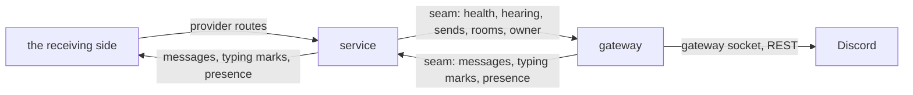

# The Discord provider's boundary

This document is the boundary of `bmo-discord`: every route it serves, every call it makes on another unit,
the seam between its two processes, and the configuration it reads. A unit reaches this provider only across
it, and the provider reaches another unit only by the calls below. `docs/api.md` is the fixed form of the API
stated here, and `docs/openapi.json` is that API in machine form.

The provider is two processes of one repository:

- **the service**, the Rust package at the root. It is the chat provider bmo-chat's contract describes: it
  declares the provider, runs the `discord-markdown` dialect, serves the protocol's provider routes and hands
  what its rooms say to the receiver. It is the only process another unit talks to.
- **the gateway**, the bun package in `gateway/`. It holds the bot account's gateway socket and the owner's
  account's token, and makes every REST call to Discord: it reads the rooms, performs the sends, answers the
  room questions and keeps the provider's own numbers (`docs/discord.md`, 「Numbering」). Only the service calls
  it, over the loopback.

## Routes served

### The chat protocol's provider routes

Every provider route of bmo-chat's `docs/protocol.md`, served by bmo-chat's provider server exactly as the
protocol and its `docs/openapi/provider.json` state them, under `BMO_DISCORD_ROUTE_TOKEN`. This repository
adds no public route beside them.

### This repository's own routes

The routes the gateway calls, stated with the seam (「The service's routes, called by the gateway」). They are on
the loopback and take the same bearer as every other route.

## Calls made on the receiving side

Every hand-over goes through bmo-chat's receiver link to `BMO_DISCORD_RECEIVER_URL`, with
`BMO_DISCORD_RECEIVER_TOKEN`, as the protocol states it:

| Route | What is handed over |
|---|---|
| `PUT /rooms/{roomId}/messages/{messageId}` | a message a room said (`live`), a message already handed over and changed (`edit`), and the agent's own words read back down a socket (`live`) |
| `POST /typing-marks` | a person writing in a room the receiving side listens to, as a `TypingMark` with a ten-second `lastsMs` |
| `POST /presence-changes` | whether people who stand in a room the receiving side listens to are reachable, as a `PresenceChange`, `whole` on becoming ready |

What the provider hands over:

- **A message is handed over once.** The store marks its snowflake as handed over, so a socket that reads it
  again after a reconnect finds it already handed over.
- **The agent's own words come back down the socket** like everybody else's. They are handed over under the
  agent's number in that room, and the receiving side keeps them and wakes nobody for them.
- **A file is a mark.** A picture is handed over as the picture mark and any other file as the file mark
  naming it (`lang/ko.toml`); no bytes cross, and the provider declares no `fetchMedia`.
- **Room facts travel with the hand-over.** `room.kind`, `room.identity` and `room.privateTo` carry what the
  provider already knows, so the receiving side need not ask for it.
- **The context** carries the author's handle as `senderUsername`, the words the author typed as
  `spokenText`, Discord's own payload as `metadata`, and `carriesFile` where the message carried a file.

- **A typing mark and a presence change go only where the provider declares what hears them.** The link is
  told the provider it serves, and drops a mark while `peopleTyping` is not declared and a change while
  `presence` is not (`docs/discord.md`, 「Typing and presence」).

### Needed from the receiving side

| Route | What is asked |
|---|---|
| `GET /rooms/{roomId}` | whether the receiving side listens to a room, asked before a typing mark or a presence change about it is told |

## The seam between the service and the gateway

Both processes listen on 127.0.0.1 only. Every seam route takes `BMO_DISCORD_ROUTE_TOKEN` as its bearer and
answers 401 without it. Bodies are JSON in camelCase, in the protocol's own shapes wherever the protocol has
one. A failure is answered with the protocol's error shape.

### The gateway's routes, called by the service

| Route | Body | Answer |
|---|---|---|
| `GET /health` | | `ready` (boolean), `reason` (string or null) and `version`: ready where the bot token is unset, saying so, or where Discord has accepted it; not ready, saying which, while Discord has not yet answered and once it has rejected the token (`docs/discord.md`, 「The bot token」) |
| `POST /sends` | the protocol's `ChatSendRequest`, of a kind the declaration carries, as JSON with every file inline: a file the service received as a part is read from its spool into the body, after the service has refused one larger than the dialect's `fileBytes` | 201 with `messageId` and `missed`; a refusal or a failure in the error shape |
| `GET /rooms/{roomId}` | | the protocol's `ProviderRoom`, its `modes` the voices whose account answers the room; the service keeps those its declaration has active. 404 `not-found` where the number is not this provider's |
| `GET /owner` | | the protocol's `ProviderOwner`: `roomId` (number or null) |
| `GET /owner-account` | | the protocol's `ChatHealth` read for the owner's account: `ready` once the gateway has confirmed it with Discord, `reason` why not, and `version` |
| `GET /hearing` | | what the bot account's socket hears beside messages: `peopleTyping` and `presence`, each `heard` (boolean) and `reason` (string or null) |

### The service's routes, called by the gateway

| Route | Body | Answer |
|---|---|---|
| `PUT /rooms/{roomId}/messages/{messageId}` | the protocol's `HandedMessage` | the message as the receiving side holds it, 201 or 200; the receiving side's failure in the error shape |
| `POST /typing-marks` | the protocol's `TypingMark` | 204 once told, or passed over where the receiving side does not listen to the room; the receiving side's failure in the error shape |
| `POST /presence-changes` | a `PresenceInRooms`: `via`, `whole`, and `people`, each the protocol's `PersonPresence` beside `roomIds`, the rooms the person stands in | 204 once the people who stand in a room the receiving side listens to are told; the receiving side's failure in the error shape |

The service tells the receiving side a typing mark only of a room it listens to, and a presence change only of
the people who stand in one, asking it of each room named; a `whole` change is told whole even where nobody in
it stands in such a room.

The gateway offers a hand-over again, every two seconds, only while the service refuses the connection, and
keeps offering it until the service is reached; a hand-over that reached the service waits for its answer,
however long. A hand-over the service answers with a failure is not marked as handed over, so the next socket
that reads the same message offers it again. A presence change is offered again the same way, while the service
refuses the connection; a typing mark is offered once, since one offered late tells a mark that has already
ended.

## Configuration

Both processes read the same environment, which the deployment's env file supplies.

The platform's own, kept as they have always been named:

| Variable | Read by | Meaning |
|---|---|---|
| `BMO_DISCORD_TOKEN` | both | the application's bot token; the `bot-account` mode is inactive without it |
| `BMO_DISCORD_OWNER_ID` | gateway | the owner's Discord account id, so the owner's words are filed under the owner's number; the owner's account is confirmed only as this account |
| `BMO_DISCORD_OWNER_CHANNEL` | gateway | the DM channel that is the owner's one-to-one with the agent; a channel says it is a DM, never whose |
| `BMO_DISCORD_STICKERS` | gateway | the agent's stickers as `emoji:id` pairs separated by commas; a sticker asked for by an emoji not paired is refused |

Without `BMO_DISCORD_TOKEN` the provider is not configured and says so, and every mode stays down. That is a
deployment with no Discord application, not a failing one: both processes serve, and health answers ready,
naming the missing setting and the modes that are down (`docs/api.md`, 「Health」). A token that is set but that
Discord rejects is a failing deployment, and health answers not ready.

The owner's account, which the `human-reader` and `human-avatar` modes send through (`docs/discord.md`, 「The
owner's account」). An operator who stands them up sets the owner's token and id beside the bot token, and the
gateway confirms the account with Discord before either mode stands; the prefix and the pace are optional:

| Variable | Read by | Meaning |
|---|---|---|
| `BMO_DISCORD_OWNER_TOKEN` | gateway | the owner's own user token; the owner's account modes are inactive until the gateway has confirmed with Discord that it is the account `BMO_DISCORD_OWNER_ID` names |
| `BMO_DISCORD_AVATAR_PREFIX` | gateway | the agent's prefix a `human-avatar` send carries where the send names none |
| `BMO_DISCORD_OWNER_PACE_MS` | gateway | the least time, in milliseconds, between one call on the owner's account ending and the next starting; `owner_pace_ms` in `policy/discord.toml` where unset |

No setting stands up the `own-account` mode: it is on an account made for the agent and declared
`unsupported` (`docs/discord.md`, 「The declaration」).

This provider's own:

| Variable | Read by | Meaning |
|---|---|---|
| `BMO_DISCORD_PORT` | both | the loopback port the service listens on; 3230 where unset |
| `BMO_DISCORD_GATEWAY_PORT` | both | the loopback port the gateway listens on; 3231 where unset |
| `BMO_DISCORD_ROUTE_TOKEN` | both | the bearer every route of the service and of the gateway takes; required |
| `BMO_DISCORD_RECEIVER_URL` | service | the receiving side's base address; required |
| `BMO_DISCORD_RECEIVER_TOKEN` | service | the token the receiving side's routes take; required |
| `BMO_DISCORD_DATA` | gateway | the provider's own data folder, inside no checkout; it holds the number store. Required |
| `BMO_DISCORD_SENDER_NAME` | gateway | the name the agent's own words are handed over under |
| `BMO_DISCORD_CLIENT_NAME` | gateway | the client name the bot account's socket identifies itself with to Discord |
| `BMO_DISCORD_API_URL` | gateway | the REST address every call goes to; Discord's own, `https://discord.com/api/v10`, where unset. The gateway's tests name a stand-in's here |

## Commands

The service's binary, `bmo-discord`, has two verbs: `serve` runs the service, and `health` answers 0 once the
running service's own `GET /health` says ready, for the deployment's health check. Where the ready answer
carries a reason, such as a provider with no Discord application, `health` prints it on one line. It answers 1,
with the reason, where the service does not answer or answers not ready.

## The clients

`docs/openapi.json` is this repository's own API. `tools/generate.ts` generates both clients from it:

| Client | File | Calls |
|---|---|---|
| Rust | `src/seam.rs` | the gateway's routes |
| TypeScript | `gateway/src/seam.ts` | the service's hand-over route |

Neither client is edited by hand. The provider routes another unit calls are reached through bmo-chat's own
published clients, `bmo-chat` and `bmo-chat-client`; this repository writes no client of them.

## Contract gaps

Statements this provider's callers rely on that a sibling's document does not yet match, each for that sibling
to take up:

- **bmo-chat's contract says a platform whose terms forbid automating a person's account declares
  `human-avatar` `unsupported`.** Discord's terms do forbid it, and this provider declares `human-avatar` and
  `human-reader` on the owner's account all the same, standing on his own settings, because the owner has
  decided to run his own account here at his own risk. The contract's sentence leaves no room for a person who
  accepts that risk for his own account; until it does, this provider departs from it on that point alone.
- **bmo-chat publishes no TypeScript client.** Its two Rust crates serve a Rust provider, and the gateway's
  protocol pieces (`gateway/src/chat.ts`) are written here from bmo-chat's `docs/contract.md` and
  `docs/protocol.md`. Until a TypeScript package is published, a change in those shapes is matched here by
  hand.
