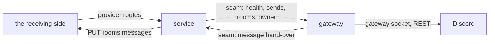

# The Discord provider's boundary

This document is the boundary of `bmo-discord`: every route it serves, every call it makes on another unit,
the seam between its two processes, and the configuration it reads. A unit reaches this provider only across
it, and the provider reaches another unit only by the calls below. `docs/api.md` is the fixed form of the API
stated here, and `docs/openapi.json` is that API in machine form.

The provider is two processes of one repository:

- **the service**, the Rust package at the root. It is the chat provider bmo-chat's contract describes: it
  declares the provider, runs the `discord-markdown` dialect, serves the protocol's provider routes and hands
  what its rooms say to the receiver. It is the only process another unit talks to.
- **the gateway**, the bun package in `gateway/`. It holds the bot account's gateway socket and makes
  every REST call to Discord: it reads the rooms, performs the sends, answers the room questions and keeps the
  provider's own numbers (`docs/discord.md`, 「Numbering」). Only the service calls it, over the loopback.

## Routes served

### The chat protocol's provider routes

Every provider route of bmo-chat's `docs/protocol.md`, served by bmo-chat's provider server exactly as the
protocol and its `docs/openapi/provider.json` state them, under `BMO_DISCORD_ROUTE_TOKEN`. This repository
adds no public route beside them.

### This repository's own route

| Route | Body | Answer |
|---|---|---|
| `PUT /rooms/{roomId}/messages/{messageId}` | a `HandedMessage` as bmo-chat's `docs/contract.md` states it | 201 where the receiving side did not hold the message before and 200 where it did, with the message as held; the receiving side's own error shape where it could not take it |

The route is on the loopback and takes the same bearer as every other route.

## Calls made on the receiving side

Every hand-over goes through bmo-chat's receiver link to `BMO_DISCORD_RECEIVER_URL`, with
`BMO_DISCORD_RECEIVER_TOKEN`, as the protocol states it:

| Route | What is handed over |
|---|---|
| `PUT /rooms/{roomId}/messages/{messageId}` | a message a room said (`live`), a message already handed over and changed (`edit`), and the agent's own words read back down a socket (`live`) |

What the provider hands over:

- **A message is handed over once.** The store marks its snowflake as handed over, so a socket that reads it
  again after a reconnect finds it already handed over.
- **The agent's own words come back down the socket** like everybody else's. They are handed over under the
  agent's number in that room, and the receiving side keeps them and wakes nobody for them.
- **A file is a mark.** A picture is handed over as the picture mark and any other file as the file mark
  naming it (`lang/ko.toml`); no bytes cross, and the provider declares no `fetchMedia`.
- **Room facts travel with the hand-over.** `room.kind`, `room.identity` and `room.privateTo` carry what the
  provider already knows, so the receiving side need not ask for it.
- **The context** carries the author's handle as `senderUsername`, the words the author typed as
  `spokenText`, Discord's own payload as `metadata`, and `carriesFile` where the message carried a file.

### Needed from the receiving side

Nothing. The only route this provider calls is the protocol's hand-over route.

## The seam between the service and the gateway

Both processes listen on 127.0.0.1 only. Every seam route takes `BMO_DISCORD_ROUTE_TOKEN` as its bearer and
answers 401 without it. Bodies are JSON in camelCase, in the protocol's own shapes wherever the protocol has
one. A failure is answered with the protocol's error shape.

### The gateway's routes, called by the service

| Route | Body | Answer |
|---|---|---|
| `GET /health` | | `ready` (boolean), `reason` (string or null) and `version` |
| `POST /sends` | the protocol's `ChatSendRequest`, of a kind the declaration carries | 201 with `messageId` and `missed`; a refusal or a failure in the error shape |
| `GET /rooms/{roomId}` | | the protocol's `ProviderRoom` but its `modes`, which the service fills from its declaration; 404 `not-found` where the number is not this provider's |
| `GET /owner` | | the protocol's `ProviderOwner`: `roomId` (number or null) |

### The service's route, called by the gateway

| Route | Body | Answer |
|---|---|---|
| `PUT /rooms/{roomId}/messages/{messageId}` | the protocol's `HandedMessage` | the message as the receiving side holds it, 201 or 200; the receiving side's failure in the error shape |

The gateway offers a hand-over again only while the service refuses the connection, within the protocol's
patience window, as the protocol's retry rule states. A hand-over that still does not go is not marked as handed
over, so the next socket that reads the same message offers it again.

## Configuration

Both processes read the same environment, which the deployment's env file supplies.

The platform's own, kept as they have always been named:

| Variable | Read by | Meaning |
|---|---|---|
| `BMO_DISCORD_TOKEN` | both | the application's bot token; the `bot-account` mode is inactive without it |
| `BMO_DISCORD_OWNER_ID` | gateway | the owner's Discord account id, so the owner's words are filed under the owner's number |
| `BMO_DISCORD_OWNER_CHANNEL` | gateway | the DM channel that is the owner's one-to-one with the agent; a channel says it is a DM, never whose |
| `BMO_DISCORD_STICKERS` | gateway | the agent's stickers as `emoji:id` pairs separated by commas; a sticker asked for by an emoji not paired is refused |

Without `BMO_DISCORD_TOKEN` the provider is not configured and says so, and the `bot-account` mode stays down.
No setting stands up the `human-reader`, `human-avatar` or `own-account` mode: all three are on a user account
and declared `unsupported` (`docs/discord.md`, 「The declaration」), and the provider reads no user account's
token.

This provider's own:

| Variable | Read by | Meaning |
|---|---|---|
| `BMO_DISCORD_PORT` | both | the loopback port the service listens on; 3230 where unset |
| `BMO_DISCORD_GATEWAY_PORT` | both | the loopback port the gateway listens on; 3231 where unset |
| `BMO_DISCORD_ROUTE_TOKEN` | both | the bearer every route of the service and of the gateway takes; required |
| `BMO_DISCORD_RECEIVER_URL` | service | the receiving side's base address; required |
| `BMO_DISCORD_RECEIVER_TOKEN` | service | the token the receiving side's routes take; required |
| `BMO_DISCORD_DATA` | gateway | the provider's own data folder, inside no checkout; it holds the number store. Required |
| `BMO_DISCORD_SENDER_NAME` | gateway | the name the agent's own words are handed over under |
| `BMO_DISCORD_CLIENT_NAME` | gateway | the client name the bot account's socket identifies itself with to Discord |

## Commands

The service's binary, `bmo-discord`, has two verbs: `serve` runs the service, and `health` answers 0 once the
running service's own `GET /health` says ready, for the deployment's health check.

## The clients

`docs/openapi.json` is this repository's own API. `tools/generate.ts` generates both clients from it:

| Client | File | Calls |
|---|---|---|
| Rust | `src/seam.rs` | the gateway's routes |
| TypeScript | `gateway/src/seam.ts` | the service's hand-over route |

Neither client is edited by hand. The provider routes another unit calls are reached through bmo-chat's own
published clients, `bmo-chat` and `bmo-chat-client`; this repository writes no client of them.

## Contract gaps

Statements this provider's callers rely on that a sibling's document does not yet match, each for that sibling
to take up:

- **bmo-chat publishes no TypeScript client.** Its two Rust crates serve a Rust provider, and the gateway's
  protocol pieces (`gateway/src/chat.ts`) are written here from bmo-chat's `docs/contract.md` and
  `docs/protocol.md`. Until a TypeScript package is published, a change in those shapes is matched here by
  hand.
