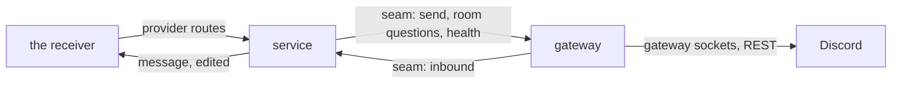

# The Discord provider's boundary

This document is the boundary of `bmo-discord`: every route it serves, every call it makes on another unit,
the seam between its two processes, and the configuration it reads. A unit reaches this provider only across
it, and the provider reaches another unit only by the calls below.

The provider is two processes of one repository:

- **the service**, the Rust package at the root. It is the chat provider bmo-chat's contract describes: it
  declares the provider, runs the `discord-markdown` dialect, serves the protocol's provider routes and hands
  what its rooms say to the receiver. It is the only process another unit talks to.
- **the gateway**, the bun package in `gateway/`. It holds the Discord accounts' gateway sockets and makes
  every REST call to Discord: it reads the rooms, performs the sends, answers the room questions and keeps the
  provider's own numbers (`docs/discord.md`, 「Numbering」). Only the service calls it, over the loopback.

## Routes served

### The chat protocol's provider routes

Every provider route of bmo-chat's `docs/protocol.md`, served by bmo-chat's provider server exactly as the
protocol and its `openapi.json` state them, under `BMO_DISCORD_ROUTE_TOKEN`:

| Route | What it answers |
|---|---|
| `GET /declaration` | the provider's declaration (`docs/discord.md`, 「The declaration」) |
| `GET /health` | `ready` once the gateway answers and at least one account's mode is active; the reason while not |
| `POST /send` | one send of a declared verb, performed by the gateway; any other verb is refused `unsupported-capability` |
| `POST /media` | refused `unsupported-capability`: the provider declares no `fetchMedia` |
| `POST /dialect/read` | the `discord-markdown` dialect reading markdown |
| `POST /dialect/check` | the `discord-markdown` dialect checking markup it built; it never faults |
| `POST /room/owns` | whether the room is one the provider has numbered |
| `POST /room/identity` | the agent's number in the room: the number of the account that answers it, or the avatar voice's own number where the room is answered in that voice |
| `POST /room/is-owner` | `owner` for the owner's one-to-one with the agent, `group` otherwise, and never `owner` for a room answered in the avatar voice |
| `POST /room/private-of` | the one person of a DM channel, as the platform said it; null for a group DM, a guild channel and a room answered in the avatar voice |
| `POST /room/title` | the channel's name as Discord gives it, or null |
| `GET /owner-room` | the room numbered for `BMO_DISCORD_OWNER_CHANNEL`, or null where it is unset or not yet numbered |

Wire conventions, auth, the error shape and the retry rule are the protocol's.

### This repository's own routes

None beside the protocol's. The seam's service route below answers only on the loopback, for the gateway.

## Calls made on the receiver

### The chat protocol's receiver routes

Every hand-over goes through bmo-chat's receiver link to `BMO_DISCORD_RECEIVER_URL`, with
`BMO_DISCORD_RECEIVER_TOKEN`, as the protocol states it:

| Route | What is handed over |
|---|---|
| `POST /message` | a message a room said, read by any of the accounts; and the agent's own words read back down a socket |
| `POST /edited` | a message already handed over, said again with different words |

What the provider hands over:

- **A message two accounts both see is handed over once.** Its snowflake is the same on every socket, so the
  first socket to read it hands it over and the others find it already numbered.
- **The agent's own words come back down the socket** like everybody else's. They are handed over under the
  agent's number in that room, and the receiver keeps them and wakes nobody for them. A send in the avatar
  voice that carried no words of its own is handed over the same way once it is made.
- **A file is a mark.** A picture is handed over as the picture mark and any other file as the file mark
  naming it (`lang/ko.toml`); no bytes cross and no `attachment` or `gathered` is made.
- **No room facts cross with a hand-over.** The receiver asks the room routes for what it needs of a room.
- **The context** carries the author's handle as `senderUsername`, the words the author typed as
  `spokenText`, Discord's own payload as `metadata`, and `carriesFile` where the message carried a file.

### Needed from the receiver

Nothing. Every hand-over this provider makes is a protocol route the receiver's boundary states.

## The seam between the service and the gateway

Both processes listen on 127.0.0.1 only. Every seam route takes `BMO_DISCORD_ROUTE_TOKEN` as its bearer and
answers 401 without it. Bodies are JSON in camelCase, in the protocol's own shapes wherever the protocol has
one. A failure is answered with the protocol's error shape.

### The gateway's routes, called by the service

| Route | Body | Answer |
|---|---|---|
| `GET /health` | | `ready` (boolean), `reason` (string or null): whether any account's socket is open, and why not |
| `POST /gateway/send` | the protocol's send request, of a verb the declaration carries | the protocol's send result: `sent` with `messageId`, or `refused` with a bmo-chat refusal as its code, `label` and fields; the service writes the refusal's sentence |
| `POST /gateway/room/owns` | `chatId` | `owns` (boolean) |
| `POST /gateway/room/identity` | `chatId` | `identity` (number or null) |
| `POST /gateway/room/is-owner` | `chatId` | `kind` (`owner` or `group`) |
| `POST /gateway/room/private-of` | `chatId` | `person` (number or null) |
| `POST /gateway/room/title` | `chatId` | `title` (string or null) |
| `GET /gateway/owner-room` | | `chatId` (number or null) |

### The service's route, called by the gateway

| Route | Body | Answer |
|---|---|---|
| `POST /service/inbound` | `kind` (`message` or `edited`) and the hand-over's body as the protocol states it | `{}` once the service has handed it on; the receiver's failure in the error shape |

## Configuration

Both processes read the same environment, which the deployment's env file supplies.

The platform's own, kept as they have always been named:

| Variable | Read by | Meaning |
|---|---|---|
| `BMO_DISCORD_TOKEN` | both | the application's bot token; the `bot-account` mode is inactive without it |
| `BMO_DISCORD_USER_TOKEN` | both | the owner's own user token; the `human-reader` and `human-avatar` modes are inactive without it |
| `BMO_DISCORD_SELF_TOKEN` | both | the user token of an account that belongs to the agent; the `human-as-agent` mode is inactive without it |
| `BMO_DISCORD_OWNER_ID` | gateway | the owner's Discord account id, so the owner's words are filed under the owner's number |
| `BMO_DISCORD_OWNER_CHANNEL` | gateway | the DM channel that is the owner's one-to-one with the agent; a channel says it is a DM, never whose |
| `BMO_DISCORD_STICKERS` | gateway | the agent's stickers as `emoji:id` pairs separated by commas; a sticker asked for by an emoji not paired is refused |

With none of the three tokens set the provider is not configured and says so; each mode stands or stays down on
its own token.

This provider's own:

| Variable | Read by | Meaning |
|---|---|---|
| `BMO_DISCORD_PORT` | both | the loopback port the service listens on; 3230 where unset |
| `BMO_DISCORD_GATEWAY_PORT` | both | the loopback port the gateway listens on; 3231 where unset |
| `BMO_DISCORD_ROUTE_TOKEN` | both | the bearer every route of the service and of the gateway takes; required |
| `BMO_DISCORD_RECEIVER_URL` | service | the receiver's base address; required |
| `BMO_DISCORD_RECEIVER_TOKEN` | service | the token the receiver's routes take; required |
| `BMO_DISCORD_DATA` | gateway | the provider's own data folder, inside no checkout; it holds the number store. Required |
| `BMO_DISCORD_AVATAR_PREFIX` | both | the prefix the agent's words carry in the avatar voice, which the deployment writes from the agent's registration; the `human-avatar` mode is inactive while it is unset |
| `BMO_DISCORD_SENDER_NAME` | gateway | the name the agent's own words are handed over under |
| `BMO_DISCORD_CLIENT_NAME` | gateway | the client name each socket identifies itself with to Discord |

## Commands

The service's binary, `bmo-discord`, has two verbs: `serve` runs the service, and `health` answers 0 once the
running service's own `GET /health` says ready, for the deployment's health check.

## Contract gaps

Statements this provider makes that a sibling's document does not yet match, each for that sibling to take up:

- **bmo-chat's** `human-avatar` voice says the caller supplies the prefix, but no send field carries one, so
  the provider takes it from `BMO_DISCORD_AVATAR_PREFIX`.
