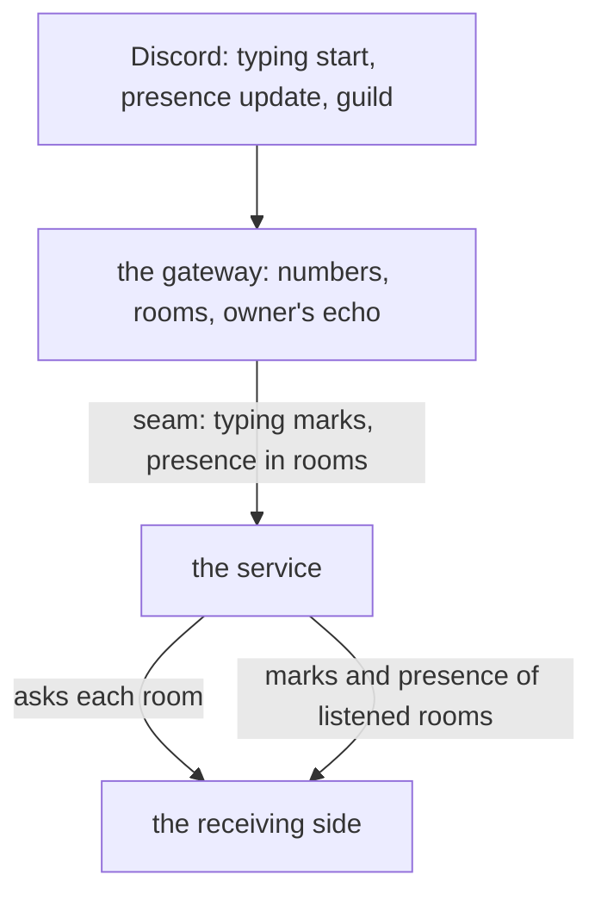

# Discord

The Discord chat provider: one chat provider like the others, and the one with the most verbs. It listens on
a gateway socket it opens itself and speaks over Discord's REST API, with no vendor library in between: what a
library would do here is the gateway's own hundred lines plus everything this provider does not use. The
routes, the seam and the settings are in `docs/boundary-api.md`; this document is what the provider is, how it
is set up and what it can do.

## What has to exist before anything runs

- **An application and its bot account**, made in Discord's developer portal. The bot token is what both
  sides authenticate with.
- **The MESSAGE_CONTENT intent, enabled for that application.** It is privileged: without it the gateway
  refuses the connection outright, and the bot account's socket says which intent to turn on and stands down
  rather than reconnecting for ever. An application in more than a hundred servers is reviewed before it is
  granted.
- **The bot invited into a guild**, with permission to read and send in the channels it is meant to be in.
- **For presence, the presence intent enabled for that application.** It is privileged and switched on in the
  developer portal, under the Discord account that owns the application. Without it everything else runs, and
  the provider declares no `presence` and says why (「Typing and presence」).

- **For the modes on the owner's account, the owner's own user token**, `BMO_DISCORD_OWNER_TOKEN`, with
  `BMO_DISCORD_OWNER_ID` naming the same account, which the gateway confirms with Discord itself. Discord's
  terms forbid automating a user account and can end the account for it (`policy/discord.toml`); the owner's
  account runs here on his own decision and at his own risk, so only his own setting stands it up and every call
  made on it keeps the provider's pace (「The owner's account」). No account made for the agent is part of the
  setup.

## The declaration

| Member | Value |
|---|---|
| `key` | `discord` |
| `label` | the platform's name in this repository's language pack, `lang/ko.toml` |
| `configured` | null where `BMO_DISCORD_TOKEN` is set, else the sentence naming it |
| `can` | `text`, `replyTo`, `photo`, `document`, `sticker`, `reaction`, `pin`, `typing`, `edit`, as `policy/discord.toml` lists them; `peopleTyping` while the bot account's socket runs, and `presence` while it runs with the presence intent granted (「Typing and presence」) |
| `dialect` | `discord-markdown` (「The dialect」) |
| `shows` | null |
| `numbering` | `assigned` for rooms, people and messages, with the rooms' and people's ranges declared (「Numbering」) |
| `speakers` | false |

The modes. The bot account's stands on its token: the service reads the setting as it starts, so a token put in
place stands the mode up with the next start, and the gateway reads it each time it opens its socket or sends.
While the gateway answers that Discord has not accepted the token, the mode waits on that (「The bot token」).
The two on the owner's account stand on the gateway having confirmed that account with its own call, which the
service reads from the gateway as it runs (「The owner's account」).

| Voice | Reach | Standing | `canReplyTo` |
|---|---|---|---|
| `bot-account` | `all-messages` | active when `BMO_DISCORD_TOKEN` is set and the gateway does not answer that Discord has not accepted it | true |
| `human-reader` | `all-messages` | active when `bot-account` is and the gateway has confirmed the owner's account | false |
| `human-avatar` | `all-messages` | active when `bot-account` is and the gateway has confirmed the owner's account | false |
| `own-account` | `all-messages` | `unsupported` | false |

An inactive mode's reason says what it waits on: the bot token where it is missing, what the gateway answered
of the bot token where Discord has not accepted it, and otherwise, for the owner's account, what the gateway's
confirmation answered.

- **The bot account reads every room.** It is the one account the provider holds a socket for, and every
  message a room says, the owner's among them, is delivered on it.
- **`human-reader` and `human-avatar` are the owner's account, sending.** They stand on the bot account too,
  since what they say is read back on its socket, and on the owner's account being confirmed. They read nothing
  of their own, so neither delivers a message an answer could be pinned to. What they send, and in which rooms,
  is 「The owner's account」.
- **`own-account` is `unsupported`.** It would run on an account made for the agent, which Discord's terms
  forbid automating and which nobody here has decided to risk; its reason is the terms' own words, as
  `policy/discord.toml` holds them, and no setting makes it active.
- **The rooms of the account are not listed.** The provider declares no `roomList`: the bot account cannot ask
  the platform for the one-to-one channels it is in, and the channels a guild answers with include those the
  bot cannot read, so no list the platform gives is the rooms the account is in.

## The socket

- **One gateway connection, the bot account's, kept open**: the hello names the beat, the socket heartbeats on
  it, and a dropped socket is opened again with growing delay.
- **A session is resumed where the platform lets it** and started fresh where it does not, so a blip does not
  deliver a room's messages twice or lose them.
- **A refused intent is not a blip.** The close code that says a privileged intent is not enabled, met while
  the identify asked for presence, takes the presence intent away and opens the socket again without it; met
  without it, the code stops the bot account's socket, with one line naming MESSAGE_CONTENT, instead of
  reconnecting for ever.
- **A rejected token is not a blip either.** The close code that says authentication failed stops the bot
  account's socket, with one line saying Discord rejected `BMO_DISCORD_TOKEN`, and the gateway holds the token
  as rejected (「The bot token」).
- **The socket runs** from the session's ready, or its resume, until it closes.
- **Every request of the bot account carries its token under the `Bot ` scheme**, and the identify names the
  intents the provider reads with: the guilds, guild and direct messages, MESSAGE_CONTENT, guild and direct
  message typing, and the guilds' presences while that intent is granted.
- **The bot account's own id is read off the token's first segment**, so the provider knows who it is in a
  room before the socket is open.
- **The socket identifies itself** with the client name `BMO_DISCORD_CLIENT_NAME` gives.
- **Guild channels and one-to-one DMs are this provider's rooms.** A bot account is never in a group DM.

## The bot token

Whether Discord accepts `BMO_DISCORD_TOKEN` is the gateway's to find out, and health and the bot account's mode
stand on it (`docs/api.md`, 「Health」).

- **Without the token nothing is asked.** The provider is not configured: the gateway answers ready and says the
  token is not set, and every mode is down.
- **The gateway asks Discord as it starts**, through the bot account: the current-user call, `GET /users/@me`.
  Discord answering with the account accepts the token; Discord refusing it as unauthorized or forbidden rejects
  it; a check that does not reach Discord, or meets any other failure, leaves it not yet answered.
- **The socket answers it too.** A session's ready accepts the token, and the close code that says
  authentication failed rejects it and stops the socket (「The socket」). So a token the first check could not
  ask about is accepted once the socket's session is ready.
- **The answer stands until Discord gives another.** An accepted token stays accepted through a dropped socket;
  a rejected one stays rejected until the gateway starts again, a new token with it.
- **While the token is not yet accepted, or rejected,** the gateway answers not ready saying which, and the
  service's health and the `bot-account` mode say the same.

## Which account answers a room

- **The bot account answers every room.** A send that names no voice speaks in it.
- **What the provider has heard in a room is written down per room.** The voice of the socket that heard the
  room last is written over whatever stood. A voice the store holds that is not `bot-account`, such as
  `own-account`, counts as none, and the room is answered by the bot account.
- **A send speaks with the voice it names**, or with the voice the room is answered by. `human-reader` and
  `human-avatar` speak through the owner's account, in the rooms 「The owner's account」 names; `own-account`
  is refused with the terms' words.
- **A room's `modes`** are `bot-account` in every room, and `human-reader` and `human-avatar` besides in a room
  the owner's account answers, each only while the declaration has it active.

## The owner's account

The owner's own Discord account, which `human-reader` and `human-avatar` send through. The provider holds its
token and nothing else of it: no socket is opened on it, and every room is read on the bot account's.

- **The gateway confirms the account with its own call.** As it starts, and every `owner_confirm_ms` of
  `policy/discord.toml` after, the gateway asks Discord whose the token is, through the owner's account at the
  provider's pace: the current-user call, `GET /users/@me`. The account is confirmed where Discord answers with
  the account `BMO_DISCORD_OWNER_ID` names. It is not, with the reason, where the token or the id is unset,
  where Discord refuses the token, or where the token is another account's. A call on the owner's account that
  Discord refuses as unauthorized, a send among them, takes the confirmation away at once with the same reason.
  A check that does not reach Discord, or that Discord answers with any other failure, leaves the answer that
  stood, so until the first check is answered the account is not yet confirmed.
- **The service reads the confirmation from the gateway.** Every five seconds, as it asks the gateway's health,
  the service asks the gateway for the owner's account (`docs/boundary-api.md`, 「The seam between the service
  and the gateway」) and declares the two modes from the answer. While the gateway does not answer, they are
  inactive and say so.
- **It answers a room the owner has been heard in.** The store writes a room down once a message the owner's
  account wrote arrives there on the bot account's socket, which shows the account is in the room. The owner's
  one-to-one with the agent is never one of them, and nor is any room while the account is not confirmed. A
  send through the owner's account into any other room is refused.
- **`human-avatar` carries the agent's prefix.** The words of a `text` or an `edit` sent in that voice go out
  behind the send's `prefix`, or behind `BMO_DISCORD_AVATAR_PREFIX` where the send names none; words that
  already begin with it are left as they are, and the prefix is followed by one space unless it ends in one. A
  send in that voice with no prefix from either is refused, so the owner's account never says the agent's
  words unmarked.
- **`human-reader` carries the owner's own words unprefixed.** It is the voice a send in the owner's own words
  names, and its words go out exactly as given. A prefix the send carries is ignored there, as in every voice
  but `human-avatar`.
- **It sends words and the typing state:** `text`, aimed at a message where the send names one, `edit` of a
  message it sent here itself, and `typing`. A user account cannot post embeds or the application's stickers,
  and a reaction or a pin as the owner would carry no mark of whose it is, so every other kind is refused in
  these voices.
- **Every call on it keeps the provider's pace.** The calls made through the owner's account go one at a time,
  each started no sooner than the pace after the one before it ended: `BMO_DISCORD_OWNER_PACE_MS` milliseconds,
  or `owner_pace_ms` in `policy/discord.toml` where it is unset. The calls made through the bot account do not
  wait on it.
- **Its token goes bare.** A user token is sent in the authorization header as it is, where the bot's goes
  under the `Bot ` scheme.
- **What it sent comes back as the provider's own.** Its message comes back down the bot account's socket as a
  message the owner's account wrote. The provider tells it from the owner's own typing by the nonce it sent the
  message with, by the words it is still waiting to see come back in that channel, and by the mark the store
  writes once the platform answers with the message's id. Such a message is kept under its number and the voice
  it went out in, filed under the owner's number, and named for the agent where it went out in `human-avatar`.
  Like the bot account's own words it is handed over once, under the number the send answered with, so the
  receiving side finds the message it already holds, and an edit of it is handed over as an edit.

## What a Discord room can do

- **The verbs:** text, an answer aimed at a message, a picture, a file, a sticker, a reaction, a pin, the
  typing state, and an edit of what the agent itself said. It is the fullest surface of the providers.
- **A call to Discord's REST API waits for its answer,** however long Discord takes: it ends on the answer or
  on a connection that breaks, and TCP keep-alive on the socket tells a Discord that has gone from one still
  answering.
- **A reaction is the agent's own.** A bot may add and remove only its own, which is what the provider does.
- **A sticker is named by an emoji.** Discord names a sticker by an id of its own, so `BMO_DISCORD_STICKERS`
  pairs each emoji with the application's sticker id, and a sticker asked for by an emoji the pairing does not
  hold is refused, naming the emoji.

## The dialect

`discord-markdown`, run by the service:

- **Limits:** 2,000 characters a message and a caption, ten embeds on one message, and 25 MB a file on a guild
  with no boost. Nitro and boosts raise them, and nothing here counts on that.
- **Discord reads markdown itself**, so the marks go out as they were written and nothing is converted or
  escaped: the markup is the text, the plain text is the text, and it never says it is formatted beyond that.
- **Nothing is folded here**, so a room of this dialect asks for no fold decision, and a long answer goes out
  as consecutive messages, cut at its own markdown's seams.
- **It never faults**, and a reader sees the markup as it stands.
- **What a writer is told** is the `writing` sentence in `policy/discord.toml`.

## Typing and presence

What bmo-chat's `docs/presence.md` asks of a chat service, as the bot account's socket hears it. Each is told
to the service across the seam, and the service tells the receiving side of it only for a room the receiving
side listens to (`docs/boundary-api.md`, 「Calls made on the receiving side」).

### Typing

- **Heard on the bot account's socket** through the two typing intents, guild message typing and direct
  message typing, which are not privileged.
- **Each typing start is a mark `on`** with a life of `typing_lasts_ms` in `policy/discord.toml`, ten seconds,
  as Discord gives one. Discord tells no stop, so a mark ends by its life or by the person's message.
- **Only in a room the provider has numbered,** since a channel no message has come from is no room the
  receiving side holds, and the service tells the mark only where the receiving side listens to the room.
- **The account the provider reads by is never told of.** A typing start of the bot account is passed over, and
  so is one of the owner's account in a channel where this provider sent a typing through that account within
  the mark's life: that mark is the agent's or the console's own coming back.
- **`peopleTyping` is declared while the bot account's socket runs.**

### Presence

- **Heard as the guild members' presence updates,** which need the privileged presence intent.
- **Discord's states are mapped:** online is `online`, idle is `away`, do not disturb is `online`, and offline
  is `offline`. Discord names no moment last seen, so `lastSeenAt` is null.
- **Whether the intent is granted is read from the application.** As the gateway starts and every
  `presence_check_ms` in `policy/discord.toml` after, it asks Discord for the application the bot token is
  (`GET /applications/@me`) and reads its flags: the intent is granted where they carry the presence intent,
  full or limited. The identify asks for presence only while it is granted. A check that finds it newly granted
  opens the socket again so the next identify asks for it, and a connection Discord refuses for an intent while
  presence was asked for takes it away until the next check.
- **Until it is granted, the provider says so:** the gateway's answer about what it hears carries the reason,
  and both processes write one line naming the presence intent and where it is switched on.
- **`presence` is declared while the socket runs with the intent granted.**
- **A person is told of in the rooms they stand in:** a member of a guild in every channel of that guild the
  provider has numbered, and the one person of a DM in that DM. The service tells only the people who stand in
  a room the receiving side listens to, and never the bot account.
- **A whole list on becoming ready.** After a fresh session's ready Discord sends every guild the ready names,
  with its members and their presences. Once every one has come, or `presence_gather_ms` after the ready, the
  gateway tells every person it holds a presence of as a `whole` list; a member a guild lists with no presence is
  `offline`. A guild that comes later, and every presence update, is told as a change of the people it names.
- **What it holds is kept in memory alone**, and a new session starts it again from its ready.

## Numbering

- **Rooms, people and messages are all numbered by this provider.** A Discord id is a snowflake, a 64-bit
  number written as a string and larger than a JSON number holds exactly, so the platform's ids stay strings
  and the provider's own numbers are what every hand-over and every send carries.
- **The gateway keeps the numbers** in its store, `discord.sqlite` under `BMO_DISCORD_DATA`: a number for each
  channel, each person and each message it has seen or sent, the messages it has handed over, the voice each
  room is answered by, the one person of each DM channel, the rooms the owner has been heard in, and the
  messages it sent through the owner's account with the voice each went out in, and the guild of each guild
  channel.
- **The ranges:** room numbers count down from −8,000,000,000,000 and person numbers count up from
  8,000,000,000,000, each taking one past the furthest the counter has ever reached, so a number once given is
  never given again. A message number counts up from one within its room, past the highest the room was ever
  given.
- **The declaration carries the ranges** (`policy/discord.toml`): rooms from −8,999,999,999,999 to
  −8,000,000,000,000 and people from 8,000,000,000,000 to 8,999,999,999,999, both ends included. They stand
  clear of KakaoTalk's (rooms below −9,000,000,000,000, people above 9,000,000,000,000) and of Telegram's
  native numbers, and the receiving side refuses a numbering whose ranges overlap another provider's.
- **A message is handed over once.** The store marks a message as handed over as it goes to the service, so a
  socket reading it again, after a reconnect, finds it there; a hand-over that fails takes the mark off again.
- **A DM channel is a one-to-one with the agent.** A message with no guild sends the gateway to ask the
  platform for the channel, once a run for each such channel, and a channel whose type is a DM writes down
  its recipient as the person it is with. A guild channel is nobody's.
- **The owner's words** are filed under the person numbered for `BMO_DISCORD_OWNER_ID`.

## What a message carries

- **A file is a mark in the record.** A picture is handed over as the picture mark, and any other file as the
  file mark naming it, both from `lang/ko.toml`. The provider declares no `fetchMedia`: a file somebody posted
  cannot be asked for back.
- **An author Discord gives no name for** is handed over under the unknown-sender name in `lang/ko.toml`,
  and an attachment Discord gives no file name for is named by the unnamed-file word there.
- **A message's origin says what happened.** A message a room said is handed over `live`, and one already
  handed over whose words or sender changed is handed over `edit`, so the receiving side replaces it with the
  sender the edit carries. A message taken back leaves the record as it was: a deletion is handed over to
  nobody.
- **Times are epoch milliseconds**, as the protocol states them, and rooms, people and messages cross as the
  provider's signed 64-bit numbers.

## Refusals

Every refusal is a bmo-chat refusal code with its English sentence, answered with that code's status:

| Where | Code | Detail |
|---|---|---|
| no token is set | `not-ready` | |
| a room this provider has not numbered | `platform` | "There is no room {room}." |
| a voice whose account is not held or not confirmed, or a voice Discord has no account for | `platform` | "That account cannot send: {why}." |
| a voice on the owner's account in a room that account does not answer | `platform` | "The owner's account does not answer room {room}." |
| a kind the owner's account does not send | `platform` | "The owner's account does not send a {kind}." |
| an edit through the owner's account of a message it did not send | `platform` | "The owner's account did not send message {message}." |
| a `typing` send for an account the send names (`accountId`) | `platform` | "This provider shows typing only in the bot account and the owner's account, not for account {account}." |
| a `human-avatar` send with no prefix | `platform` | "A human-avatar send needs a prefix, and neither the send nor BMO_DISCORD_AVATAR_PREFIX gives one." |
| an edit, a reaction or a pin of a message this provider has not numbered | `platform` | "There is no message {message}." |
| a sticker the pairing does not hold | `platform` | "No sticker is paired with {emoji}." |
| a document larger than the dialect's `fileBytes` | `platform` | "The file is {size} bytes, and Discord takes at most {limit}." |
| a send the declaration does not carry | `unsupported-capability` | |

With no token set the provider is not configured, yet its health is ready, so the service answers what the
base would otherwise turn away as not ready itself, without asking the gateway: a send is refused `not-ready`,
a room is none this provider owns, and the owner has no room.

## Tests

The health test holds the service's health: ready with no bot token, its reason naming the missing setting and
every mode down, with a send, a room and the owner answered as an unconfigured provider answers them without
asking the gateway; ready once a stand-in gateway answers ready with the token set; and not ready, with the
`bot-account` mode waiting on it, where the stand-in gateway answers that Discord rejected the token. The
declaration test holds the modes and the capabilities the service declares: `bot-account` active when its
token is set, `human-reader` and `human-avatar` active once the gateway has confirmed the owner's account and
inactive saying what they wait on otherwise, `own-account` unsupported with the terms' words whatever is set,
and the nine capabilities, read from a stand-in gateway's answer about the owner's account. The hearing test
holds `peopleTyping` and `presence` declared as a stand-in gateway answers it hears each, and the service
telling a stand-in receiving side a typing mark only of a room it listens to and a presence change only of the
people who stand in one, a `whole` change whole. The room-modes test holds a room's voices narrowed to the
active ones. The document test holds a document held on disk going to a stand-in gateway inline, and one
larger than the file limit refused by its size without the gateway being asked. The gateway's owner-account test, against a stand-in Discord,
holds the confirmation (the named account confirmed; another account, a refused token and an unset token not),
a room offered the owner's voices only while the account is confirmed, a `human-avatar` send going out behind
the prefix and a `human-reader` send exactly as given, both on the bare user token, the bot account's send on
its `Bot ` scheme, and a `human-avatar` send with no prefix refused. The gateway's bot-token test, against a stand-in Discord, holds the gateway's
health: ready saying the token is not set where it is unset, not ready until Discord has answered, ready once
Discord accepts the token and not ready, naming the rejection, once Discord refuses it. The gateway's typing-and-presence test
holds a typing start told as a ten-second mark only in a numbered room and never of the bot account, the
owner's typing start passed over within a mark's life of this provider typing through his account, a typing
send for another account refused with nothing typed, the identify asking for the typing intents always and for
presence only where it is granted, a fresh session's guilds told as one whole list with idle as `away`, do not
disturb as `online` and a listed member with no presence as `offline`, and each person told beside the rooms
they stand in. The rest of the behaviour tests are deferred: no Discord test account is connected, so nothing here, the owner's account least of all, has been
tried against a live Discord server.
